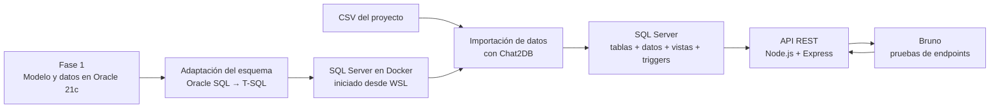

# Comercial La Estrella — Proyecto 2

**Bases de Datos 1 · Fase 2 · Carné 202300540**

Este documento describe el flujo completo para pasar del proyecto de base de datos de la Fase 1, desarrollado sobre Oracle, a la solución de la Fase 2 sobre SQL Server; iniciar el contenedor y la API; y probar los endpoints con Bruno.

## Flujo general



La migración no se realiza automáticamente entre los motores. El DDL de Oracle se adaptó al dialecto T-SQL de SQL Server, y los archivos CSV se importan a las tablas de SQL Server desde Chat2DB. La API se conecta al motor nuevo a través del puerto publicado por Docker; Bruno consume la API, no la base de datos directamente.

## Componentes

| Componente | Ubicación | Función |
|---|---|---|
| Docker Compose | `docs/docker-compose.yml` | Levanta SQL Server y conserva sus archivos en un volumen |
| DDL de SQL Server | `sql/01_BD.sql` | Crea las 17 tablas, llaves y restricciones |
| Vistas | `sql/02_vistas.sql` | Define los reportes analíticos |
| Triggers | `sql/03_trigger_1.sql`, `sql/03_trigger_2.sql` | Protege inventario y actualiza el estado de venta |
| Datos para migrar | `csv/*.csv` | Archivos para cargar las tablas desde Chat2DB |
| API | `api/server.js`, `api/src/` | Expone las rutas REST y se conecta a SQL Server |
| Solicitudes de Bruno | `api/Proyecto_2_BASES1/` | Colección para probar endpoints |

## Requisitos

- Docker Desktop con integración WSL habilitada, o Docker Engine disponible desde WSL.
- Node.js y pnpm instalados en el entorno donde se ejecutará la API.
- Chat2DB con conexión a Microsoft SQL Server.
- Bruno para abrir y enviar las solicitudes de prueba.

## 1. Iniciar SQL Server en Docker

El archivo Compose está en `docs/`. Desde WSL, sitúese en la raíz del repositorio (ajuste la ruta si guardó el proyecto en otro lugar) y levante el servicio:

```bash
docker compose "docker-compose.yml" up -d
docker ps
```

Debe aparecer el contenedor `sqlserver_2025` como activo y el puerto `1433` publicado. Para revisar el arranque:

```bash
docker logs -f sqlserver_2025
```

El volumen `sqlserver_data` persiste la base entre reinicios. Para detener el contenedor sin borrar los datos:

```bash
docker compose "docker-compose.yml" down
```

No use `down -v` a menos que quiera eliminar también el volumen de datos.

> **Versión del motor:** la configuración actual usa `mcr.microsoft.com/mssql/server:2025-latest`. El enunciado de la práctica solicita SQL Server 2022; confirme con el docente si debe cambiarse la imagen antes de entregar.

## 2. Crear la base, migrar los datos y desplegar los objetos

Con el contenedor iniciado, abra Chat2DB y cree una conexión de tipo Microsoft SQL Server:

| Campo | Valor |
|---|---|
| Host | `localhost` |
| Puerto | `1433` |
| Usuario | `sa` |
| Contraseña | La configurada como `MSSQL_SA_PASSWORD` en `docs/docker-compose.yml` |

En una conexión a la base `master`, cree la base de destino:

```sql
CREATE DATABASE Proyecto2;
```

Luego cambie la conexión de Chat2DB a `Proyecto2` y ejecute el DDL:

1. Abra y ejecute `sql/01_BD.sql` para crear las tablas.
2. Importe los CSV desde la carpeta `csv/`, respetando el orden de dependencias:

   1. `PAIS`
   2. `TIPO_TIENDA`
   3. `TIPO_IDENTIFICACION`
   4. `CARGO`
   5. `CATEGORIA`
   6. `MARCA`
   7. `ESTADO_VENTA`
   8. `METODO_PAGO`
   9. `DEPARTAMENTO`
   10. `MUNICIPIO`
   11. `TIENDA`
   12. `PRODUCTO`
   13. `EMPLEADO`
   14. `CLIENTE`
   15. `VENTA`
   16. `DETALLE_VENTA`
   17. `PAGO`

3. Ejecute `sql/02_vistas.sql`.
4. Ejecute `sql/03_trigger_1.sql` y `sql/03_trigger_2.sql`.
5. En Chat2DB, verifique que aparezcan las tablas, las tres vistas y los dos triggers.

Se recomienda importar los CSV antes de crear los triggers para que la carga inicial de detalles y pagos no active las reglas de negocio como si fueran ventas nuevas. El archivo Compose solo inicia SQL Server: **no crea automáticamente la base, no ejecuta los scripts ni importa los CSV**. Estas tareas se realizan manualmente en Chat2DB.

> Si ya existe una base cargada en el volumen `sqlserver_data`, no vuelva a crearla ni a importar los CSV encima de los datos existentes. Continúe con el paso de configuración de la API.

## 3. Configurar y arrancar la API

Abra una terminal en `api/`. Por ejemplo, desde PowerShell en la raíz del repositorio:


Edite `api/.env` con la contraseña configurada en Docker y los datos de la base:

```dotenv
PORT=3000
DB_SERVER=localhost
DB_PORT=1433
DB_NAME=ComercialLaEstrella
DB_USER=sa
DB_PASSWORD=<contraseña configurada en docker-compose.yml>
DB_TRUST_CERT=true
```

Instale dependencias (solo la primera vez) e inicie el servidor en modo desarrollo:

```powershell
pnpm install
pnpm dev
```

`pnpm dev` ejecuta `nodemon`, que reinicia el servidor cuando se modifican archivos. Mantenga esta terminal abierta mientras prueba la API. La base de datos debe estar activa y accesible antes de iniciar el servidor.

### Mensajes esperados en la consola

Cuando el servidor inicia y la conexión a SQL Server funciona, deben aparecer mensajes similares a:

```text
Servidor corriendo en http://localhost:3000
Conexión a SQL Server establecida
```

Al enviar solicitudes, Morgan registra método, ruta y estado HTTP en esa misma consola, por ejemplo:

```text
GET /api/productos 200 ...
```

Si aparece `El servidor arranco pero no hay conexion con la BD`, el proceso HTTP sí inició, pero no podrá atender correctamente las consultas hasta solucionar la conexión. Revise que el contenedor esté activo, que `DB_SERVER`, `DB_PORT`, `DB_NAME`, usuario y contraseña sean correctos, y que la base exista.

Compruebe que la API responde abriendo `http://localhost:3000/`. La respuesta debe ser JSON. No cierre esta terminal durante las pruebas.

## 4. Probar los endpoints en Bruno

Con la API funcionando, abra Bruno y cargue la colección ubicada en:

```text
[BD1]_Proyecto2_202300540/api/Proyecto_2_BASES1/
```

Las solicitudes usan `http://localhost:3000`. Seleccione una solicitud de la colección y pulse **Send**. Revise en Bruno el código HTTP y la respuesta JSON; simultáneamente, confirme en la terminal de la API el registro de la petición. Las escrituras y lecturas de la evaluación deben pasar por la API.

### Endpoints disponibles

| Recurso | Rutas implementadas |
|---|---|
| Clientes | `GET /api/clientes`, `GET /api/clientes/:id`, `POST /api/clientes`, `PUT /api/clientes/:id`, `DELETE /api/clientes/:id` |
| Productos | `GET /api/productos`, `GET /api/productos/:id`, `POST /api/productos`, `PUT /api/productos/:id`, `DELETE /api/productos/:id` |
| Tiendas | `GET /api/tiendas`, `GET /api/tiendas/:id`, `POST /api/tiendas`, `PUT /api/tiendas/:id`, `DELETE /api/tiendas/:id` |
| Empleados | `GET /api/empleados`, `GET /api/empleados/:id`, `POST /api/empleados`, `PUT /api/empleados/:id`, `DELETE /api/empleados/:id` |
| Ventas | `GET /api/ventas`, `GET /api/ventas/:id`, `POST /api/ventas`, `PUT /api/ventas/:id`, `DELETE /api/ventas/:id` |
| Detalles | `GET /api/detalles`, `GET /api/detalles/:id`, `POST /api/detalles`, `DELETE /api/detalles/:id` |
| Pagos | `GET /api/pagos`, `GET /api/pagos/:id`, `POST /api/pagos`, `DELETE /api/pagos/:id` |
| Reportes | `GET /api/reportes/ventas-ubicacion`, `GET /api/reportes/top-productos`, `GET /api/reportes/saldos-pendientes` |

Los listados de detalles y pagos aceptan el parámetro opcional `?venta=<id>`. La API actual no implementa `PUT` para detalles ni pagos.

### Escenarios que demuestran las vistas y triggers

Usando identificadores de prueba válidos y consultando el estado inicial antes de modificar datos:

1. **Inventario insuficiente:** envíe `POST /api/detalles` con una cantidad superior a la existencia del producto. Debe fallar y mostrar el error emitido por el trigger.
2. **Descuento de inventario:** envíe un detalle con cantidad válida y consulte `GET /api/productos/:id`. La existencia debe haberse reducido.
3. **Pago parcial:** inserte un pago por `POST /api/pagos` cuyo monto no cubra el total de la venta. La venta debe continuar registrada.
4. **Pago completo:** inserte el pago que completa o supera el total. Consulte `GET /api/ventas/:id` y compruebe que el estado cambió a `PAGADA`.
5. **Vistas:** consulte los tres endpoints de reportes y revise los resultados.

El trigger de inventario se ejecuta al insertar detalles: eliminar un detalle no repone el stock automáticamente. El trigger de pago se ejecuta al insertar pagos: eliminar un pago no revierte automáticamente el estado de una venta.

## 5. Qué calcula cada vista y qué hace cada trigger

### Vistas

- **`Vista_Ventas_Ubicacion`**: cantidad de ventas y facturación por tienda, municipio, departamento y país; excluye las ventas anuladas.
- **`Vista_Top_Productos`**: unidades vendidas e importe generado por producto, categoría y marca; excluye ventas anuladas.
- **`Vista_Saldos_Pendientes`**: total de cada venta registrada, total abonado y saldo pendiente.

### Triggers

- **`TR_Insert_detalle`**: valida la existencia al insertar un detalle; revierte la transacción si no hay suficiente inventario y, en caso válido, descuenta la cantidad vendida.
- **`TR_Insert_Pago`**: suma los pagos y compara el resultado con el total de los detalles; cuando se cubre el total, actualiza el estado de la venta a `PAGADA`.

## 6. Evidencia y entrega

El flujo se puede explicar con el diagrama de este README y verificar con la colección de Bruno. Para mantener la documentación breve, una captura compuesta puede mostrar la consola con la API conectada, una respuesta de Bruno y, si cabe, el contenedor activo en Docker. Para evidenciar específicamente los triggers, muestra también el rechazo por stock insuficiente y el estado `PAGADA` después del pago completo; confirma si el docente requiere capturas separadas para cada escenario.

Incluya la carpeta `api/Proyecto_2_BASES1/` en el paquete final. Está configurada como colección de Bruno/OpenCollection; si se entrega el proyecto en un ZIP, confirme que dicha carpeta esté incluida, ya que actualmente aparece excluida por una regla en `api/.gitignore`.

## Diferencias conocidas con el enunciado

- El enunciado solicita SQL Server 2022; el Compose actual apunta a SQL Server 2025.
- La inicialización de la base, ejecución del DDL e importación de datos son pasos manuales en Chat2DB, no automáticos al iniciar Docker.
- Las rutas CRUD no incluyen todas las tablas de catálogo y geografía, y detalles y pagos no tienen operación `PUT`.
- La carpeta de solicitudes está preparada para Bruno; si el docente exige una exportación de Postman, debe generarse y adjuntarse aparte.
